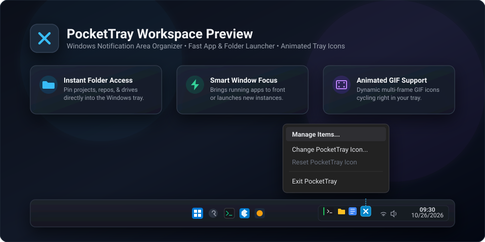

<div align="center">


# PocketTray

**A lightweight, zero-overhead taskbar & system tray organizer for Windows**

*Pin your favorite folders and apps directly to your notification area, bring active windows to focus, and bring animated GIFs to life in your tray.*

<p>
  <a href="LICENSE"></a>
  
  
  
  
  
</p>

---

<p>
  <a href="#-about-pockettray">About</a> •
  <a href="#-key-features">Features</a> •
  <a href="#-visual-tour">Visual Tour</a> •
  <a href="#-quick-start--usage">Quick Start</a> •
  <a href="#-building-from-source">Building</a> •
  <a href="#-configuration--portability">Configuration</a> •
  <a href="#-custom-icons--animations">Customization</a> •
  <a href="#-license--credits">License</a>
</p>

<p align="center">
  
</p>

</div>

---

## 📌 About PocketTray

Modern workspaces easily become cluttered: taskbars overflow with dozens of open windows, desktop shortcuts get buried under active apps, and heavy dock utilities consume precious memory and battery.

**PocketTray** reimagines the Windows notification area (system tray) as a clean, lightning-fast pocket launcher. It lets you pin your essential applications and everyday folders right beside the clock, offering immediate access without sacrificing desktop screen real estate.

- 🪟 **100% Portable & Self-Contained**: PocketTray runs directly from its folder. All configuration (`config.json`) and custom icon assets live right beside the executable—no installers, no registry clutter, and zero baggage when carried on a flash drive.
- ⚡ **Smart Window Focusing**: Clicking a pinned application launches it if it is closed, or instantly brings its existing window to the front if it is already running. You can even target specific window titles (e.g., matching a particular project or terminal session).
- 📁 **Instant Directory Navigation**: Pin repositories, download directories, or shared network volumes for one-click access in Windows Explorer.
- 🎬 **Animated GIF Tray Icons**: Give your taskbar personality with animated tray icons. PocketTray extracts multi-frame GIFs and plays them smoothly in the notification area with per-frame timing.
- 🌙 **Native Windows Dark Theme**: Fully integrated with Windows 10/11 dark mode styling, complete with DWM immersive dark title bars, dark context menus, and themed dialog controls.
- 🛡️ **Zero Telemetry & Local-First**: No network pings, no background updates, no cloud dependencies. Your system, your pins, strictly local.

---

## ✨ Key Features

<table>
  <tr>
    <td width="50%">
      <h3>📂 Pinned Folders &amp; Quick Launch</h3>
      <p>Pin your most frequented directories, Git repositories, or software executables into the notification tray with custom labels and icons.</p>
    </td>
    <td width="50%">
      <h3>⚡ Smart Window Focus &amp; Launching</h3>
      <p>Clicking an app pin launches it if closed, or restores and brings its existing window straight to the foreground without spawning duplicate processes.</p>
    </td>
  </tr>
  <tr>
    <td width="50%">
      <h3>🎬 Dynamic Animated GIF Tray Icons</h3>
      <p>Supports multi-frame animated GIFs for your tray pins and anchor icon. Delays and frame timings are preserved for silky smooth playback.</p>
    </td>
    <td width="50%">
      <h3>🎯 Running Window Picker</h3>
      <p>Easily pick active desktop windows through a visual selector dialog instead of manually digging for executable paths or process names.</p>
    </td>
  </tr>
  <tr>
    <td width="50%">
      <h3>🧹 Duplicate Tray Avoidance</h3>
      <p>Enable <i>"Hide this pin while the app is running"</i> for apps that create their own tray icons (Discord, Steam, Spotify) to prevent tray duplication.</p>
    </td>
    <td width="50%">
      <h3>🌙 Immersive Windows Dark Mode</h3>
      <p>Hand-crafted dark palette automatically respects Windows system theme preferences across all management forms and context menus.</p>
    </td>
  </tr>
</table>

---

## 📸 Visual Tour

### 1. Animated Tray Icons in Action
PocketTray natively decodes animated GIFs, converts each frame into optimized 16x16 / 32x32 icon handles, and cycles them according to the GIF's internal frame delay metadata.

<p align="center">
  
  &nbsp;&nbsp;&nbsp;&nbsp;&nbsp;&nbsp;&nbsp;&nbsp;
  
</p>
<p align="center">
  <i>Both sample animations (<code>kramer.gif</code> and <code>giphy.gif</code>) are included in the repository for immediate testing.</i>
</p>

### 2. The Anchor &amp; Separator Icon
PocketTray places an anchor icon (`x-mark-512.ico`) in your notification area. This anchor serves two roles:
1. **Visual Grouping**: Separates your personal pinned items from third-party system tray icons. Windows remembers your pin placement relative to this anchor.
2. **Master Control**: Left-click the anchor to instantly open the **Manage Items** window; right-click for global settings, icon swapping, or graceful exit.

<p align="center">
  
</p>

### 3. Streamlined Item Management
Easily add, reorder, and configure pins. With the built-in **Pick Running Window...** tool, you can click any running application to automatically extract its `.exe` path and window title.

---

## 🚀 Quick Start &amp; Usage

### Running PocketTray

1. Download or compile `PocketTray.exe`.
2. Place it in any directory of your choice (e.g. `C:\Tools\PocketTray` or a portable USB drive).
3. Run `PocketTray.exe`.
4. On first launch, PocketTray opens the **Manage Items** screen so you can set up your first pins.

### Tray Interactions

| Target | Gesture | Action |
| :--- | :--- | :--- |
| **Pinned Folder** | **Left-Click** | Opens the folder directly in Windows Explorer. |
| **Pinned Folder** | **Right-Click** | Opens context menu to open folder, manage items, or remove pin. |
| **Pinned Application** | **Left-Click** | Brings running window to focus; launches `.exe` if not running. |
| **Pinned Application** | **Right-Click** | Context menu with launch options, window settings, and exit. |
| **PocketTray Anchor** | **Left-Click** | Opens the **Manage Items** configuration dialog. |
| **PocketTray Anchor** | **Right-Click** | Menu to manage items, change or reset app icon, or exit. |

### Run at Windows Startup
You can enable or disable startup launching at any time from any pinned item's context menu (**"Start with Windows"**). PocketTray registers itself under the current user's registry key (`HKCU\Software\Microsoft\Windows\CurrentVersion\Run`), requiring no administrator privileges.

---

## 🛠️ Building from Source

### Prerequisites

- **Windows 10 / 11** (x64)
- **.NET 8.0 SDK** ([Download .NET 8](https://dotnet.microsoft.com/download/dotnet/8.0))
- **Visual Studio 2022** or **VS Code** with C# Dev Kit (optional)

### Build Commands

1. **Clone the repository:**
   ```powershell
   git clone https://github.com/projectGloria/PocketTray.git
   cd PocketTray
   ```

2. **Standard Build & Run:**
   ```powershell
   # Compile project
   dotnet build

   # Run application
   dotnet run
   ```

3. **Publish Single-File Portable Executable:**
   Produce a standalone, self-contained single `.exe` with embedded dependencies and compression:
   ```powershell
   dotnet publish -c Release -r win-x64 --self-contained true /p:PublishSingleFile=true /p:EnableCompressionInSingleFile=true
   ```
   The generated executable will be placed in:
   ```text
   bin\Release\net8.0-windows\win-x64\publish\PocketTray.exe
   ```

---

## ⚙️ Configuration &amp; Portability

PocketTray stores all state inside `config.json` in the same directory as `PocketTray.exe`.

### Example `config.json`

```json
{
  "items": [
    {
      "id": "c1f7a01d9f4e44bfa293c6f4bfa58891",
      "type": 0,
      "path": "C:\\Users\\Username\\Projects",
      "label": "Projects Folder",
      "windowTitleMatch": null,
      "hideWhileRunning": false,
      "customIconPath": null
    },
    {
      "id": "e8a93d40a1b248a48ef2e256e6d1b328",
      "type": 1,
      "path": "C:\\Program Files\\Microsoft VS Code\\Code.exe",
      "label": "Visual Studio Code",
      "windowTitleMatch": "Visual Studio Code",
      "hideWhileRunning": false,
      "customIconPath": "icons\\vscode.ico"
    }
  ],
  "runAtStartup": false,
  "firstRunComplete": true,
  "appIconPath": null
}
```

### Configuration Fields

- `type`: `0` for **Folder**, `1` for **Application**.
- `path`: Full path to the directory or `.exe` binary.
- `label`: Optional display name used for tooltips and list views (defaults to folder or binary name).
- `windowTitleMatch`: Substring to look for in active top-level windows when focusing existing instances.
- `hideWhileRunning`: Hides the pin while a matching process is detected, restoring it when closed.
- `customIconPath`: Relative path inside the portable `icons\` folder for custom overrides.
- `appIconPath`: Relative path to a custom image or animated GIF for PocketTray's anchor tray icon.

---

## 🎨 Custom Icons &amp; Animations

### Supported Formats
PocketTray accepts standard image formats for both pinned items and the PocketTray anchor:
- **Icons**: `.ico` (including multi-resolution icon files)
- **Vector & Rasters**: `.png`, `.jpg`, `.jpeg`, `.bmp`
- **Animations**: `.gif` (multi-frame animated GIFs)

### Portable Asset Management
When you pick an icon or animation via the UI, PocketTray copies the file into an `icons/` subdirectory next to the executable. This guarantees:
- Absolute paths on your original machine are never hardcoded.
- You can move the PocketTray folder to another location or PC without broken icon links.

---

## 📜 License &amp; Credits

PocketTray is open-source software licensed under the **[MIT License](LICENSE)**.

- **Author**: [projectGloria](https://github.com/projectGloria)
- **Platform**: Designed natively for Windows using modern .NET 8 & Windows Forms.
- **Contributions**: Pull requests, bug reports, and suggestions are welcome!
